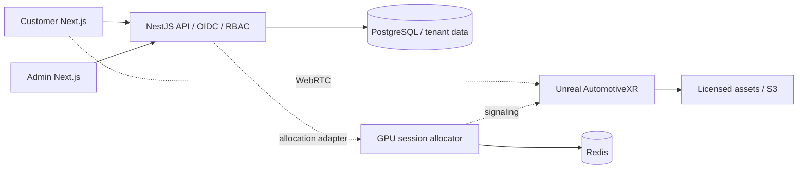

# Architecture / HLD

## Decisions

The checkout root is the monorepo root; an extra nested `automotive-xr` directory adds no isolation. Next.js customer and administrative clients call a NestJS API. PostgreSQL is the commercial system of record. Prisma uses its supported JavaScript engine with the PostgreSQL adapter, avoiding platform-specific query binaries. Redis backs atomic fixed-pool allocation and signaling session leases. API admission uses a PostgreSQL advisory lock. HTTP rate limits remain per process and must not be presented as distributed protection.

## Trust boundaries

Rendering is advisory. Only the API validates option membership, compatibility, price book and currency. Prices use integer minor units. Clients never submit accepted totals. Tenant membership comes from verified OIDC identity for protected operations. Catalog access uses an explicit public tenant slug; it grants no administrative privilege. Composite foreign keys prevent cross-tenant references.

## Modules

Catalog: vehicles, variants, options. Commerce: compatibility, price books, configurations. Identity: OIDC, role membership. CRM: dealers and consented leads. Streaming: expiring session ownership and capacity. Operations: audit events and analytics. Separate deployment boundaries for web, admin, API and GPU workloads.

## Production direction

Use ALB + ECS for HTTP services, RDS PostgreSQL, ElastiCache, S3 with private object access, an external OIDC provider, and a separately managed GPU fleet. Provisioning and deployment remain subject to the feature matrix; this document describes architecture, not a deployment claim.
